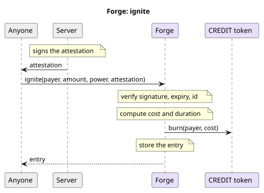

# cyberbrawl-contracts

The smart contracts behind [Cyberbrawl](https://cyberbrawl.io) TCG.

## Forge Contract

ION is [Cyberbrawl](https://cyberbrawl.io)'s crafting currency, and its price is a living market: it follows the game's economy and is re-quoted as that economy moves.

The Forge is the Stellar contract behind the ION Forge in the game. It computes the cost, the time and the settlement of CREDIT into ION on chain, so the arithmetic that carries the value is public and verifiable by anyone.

## Cost and Time Design

Ionization takes time and energy. To prime the reaction chambers to `ignite`, you must prepay the Xenon fuel reserves and system's power grid with CREDIT. You can then `collect` the ION matrix once stabilized.

An order of amount ION at power (1 to 24) costs and takes:

```
cost = amount × base × premium_bps(power) / 10,000²
time = 172,800 s / power
premium(P) = P^(ln 3 / ln 24)
```

`base` is the price of one ION in CREDIT, attested by the server. A forge takes two days whatever the amount, and only `power` shortens it. `premium_bps` is the premium in basis points, 10,000 being 1.0×:

| power | premium_bps | power | premium_bps | power | premium_bps |
|---|---|---|---|---|---|
| 1 | 10,000 | 9 | 21,373 | 17 | 26,629 |
| 2 | 12,708 | 10 | 22,166 | 18 | 27,160 |
| 3 | 14,620 | 11 | 22,908 | 19 | 27,673 |
| 4 | 16,148 | 12 | 23,608 | 20 | 28,168 |
| 5 | 17,443 | 13 | 24,270 | 21 | 28,647 |
| 6 | 18,578 | 14 | 24,900 | 22 | 29,111 |
| 7 | 19,595 | 15 | 25,501 | 23 | 29,562 |
| 8 | 20,520 | 16 | 26,076 | 24 | 30,000 |

A running forge can also be pulled early. To `extract` the ION before the matrix has stabilized, you pay the difference between the `ignite` power and the power that would have finished right now (nothing beats power 24):

```
now_power = ceil(172,800 s / elapsed)
cost = amount × base × (premium_bps(now_power) − premium_bps(power)) / 10,000²
```

### Canonical parameters

| Parameter | Value                        |
|-----------|------------------------------|
| max_power | 24                           |
| duration  | 172,800 s (two days at power 1) |

## Interface

| Function | Who | What |
|---|---|---|
| `__constructor` | deployment | Sets the admin, the CREDIT and ION assets and the attestor key, in the deployment transaction. |
| `set_attestor` | admin | Rotates the attestor key. |
| `ignite` | payer | Burns the CREDIT of an order priced on chain from an attested base. |
| `collect` | anyone | Pays out the ION of a completed order to its receiver. |
| `extract` | payer | Burns the CREDIT up to the power that finishes now, priced on chain from an attested base, and pays out the ION of a running order now. |
| `upgrade` | admin | Upgrades the contract code. |




## Attestation

Signed by the attestor with ed25519, all numbers big-endian. 152 bytes.

| Bytes | Field | Meaning |
|---|---|---|
| 0 to 15 | id | The player id as UTF-8, zero-padded on the right to 16 bytes, never truncated. The key of the forge entry, and the same 16 bytes `collect` and `extract` take. |
| 16 to 71 | receiver | The strkey of the address that receives the ION, a plain 56-character G or C address, not muxed. |
| 72 to 79 | base | CREDIT per ION, in basis points. 24.24 CREDIT per ION is 242,400. |
| 80 to 87 | expiry | A timestamp in seconds. |
| 88 to 151 | signature | Over bytes 0 to 87. |

## Deployment

Stellar mainnet.

| | Address |
|---|---|
| Contract | [CDJZCLXBQ6QRRQIPOV73HXOL5HWZBDUWHRESMD23PORSFAGZD3ELZQMH](https://stellar.expert/explorer/public/contract/CDJZCLXBQ6QRRQIPOV73HXOL5HWZBDUWHRESMD23PORSFAGZD3ELZQMH) |
| Admin | [GDMS6MPSI7DKP4VRZ4NK6LHFWUJ4QAHZ3VO22NYCKBLNOBSWDANGGAME](https://stellar.expert/explorer/public/account/GDMS6MPSI7DKP4VRZ4NK6LHFWUJ4QAHZ3VO22NYCKBLNOBSWDANGGAME) |

## Sui Package

The `sui/` Move package carries the game's assets on Sui: CREDIT, ION and SHARD as coins registered in the Coin
Registry, cards as objects with Display V2, a transfer policy with a kiosk lock and a 5% royalty, and the Vault that
mints on withdrawal from the game and burns on deposit back.

### Deployment

Sui mainnet.

| | Id |
|---|---|
| Package | [0xc0ecc184efcc2605e55b24afe103dc9d88c7e4cdc918061fcbe42d4f81fe32c3](https://suiscan.xyz/mainnet/object/0xc0ecc184efcc2605e55b24afe103dc9d88c7e4cdc918061fcbe42d4f81fe32c3) |
| Admin | [0x21ce1ae0df60205f266117770fbd33aeec158f5d51c71bc7d3909f009b82b8e6](https://suiscan.xyz/mainnet/account/0x21ce1ae0df60205f266117770fbd33aeec158f5d51c71bc7d3909f009b82b8e6) |
| Vault | [0xc7273cc889432c20eb8c091fbb0502b7154814f66c7dd4b4ce8a75babdc3ae34](https://suiscan.xyz/mainnet/object/0xc7273cc889432c20eb8c091fbb0502b7154814f66c7dd4b4ce8a75babdc3ae34) |
| Transfer policy | [0x4e3a0a78d23d1a2d0e78296348b3d0fb0ae349a665dc9ba5040a70eb0bba4e13](https://suiscan.xyz/mainnet/object/0x4e3a0a78d23d1a2d0e78296348b3d0fb0ae349a665dc9ba5040a70eb0bba4e13) |

## Building

The Forge, from the repository root:

```bash
stellar contract build
```

```bash
cargo test
```

The Sui package, from `sui/`:

```bash
sui move build
```

```bash
sui move test
```

## Source & License
`cyberbrawl-contracts` is licensed under the MIT License. See [MIT License](LICENSE) for more details.
